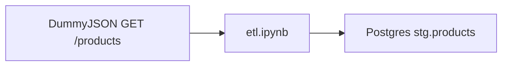

# ДЗ-1. Загрузка товаров DummyJSON в Postgres

Каталог товаров из REST API один раз загружается в Postgres.

## Источник

- Название: DummyJSON Products
- Тип: REST API
- Endpoint: `GET https://dummyjson.com/products?limit=30&skip=0`
- Объём: 194 товара. Страницы по 30, последняя короче, всего 7 запросов.
- Почему этот источник: API открытый, без ключа, есть пагинация `limit`/`skip`. Отдельный сервис для источника поднимать не надо.

### Пример ответа

```json
{
  "products": [
    {
      "id": 1,
      "title": "Essence Mascara Lash Princess",
      "description": "The Essence Mascara Lash Princess is a popular mascara known for its volumizing and lengthening effects.",
      "category": "beauty",
      "price": 9.99,
      "discountPercentage": 10.48,
      "rating": 2.56,
      "stock": 99,
      "brand": "Essence",
      "sku": "BEA-ESS-ESS-001"
    }
  ],
  "total": 194,
  "skip": 0,
  "limit": 30
}
```

### Схема источника

В таблицу попадают только эти поля. `tags`, `images`, `reviews`, `dimensions` и `meta` отбрасываются.

| Поле | Тип | Пример |
| :--- | :--- | :--- |
| `id` | number | `1` |
| `title` | string | `Essence Mascara Lash Princess` |
| `description` | string | `The Essence Mascara Lash Princess is a popular mascara...` |
| `category` | string | `beauty` |
| `price` | number | `9.99` |
| `discountPercentage` | number | `10.48` |
| `rating` | number | `2.56` |
| `stock` | number | `99` |
| `brand` | string, может не быть | `Essence` |
| `sku` | string | `BEA-ESS-ESS-001` |

Пример строки после переименования:

```text
product_id=1, title=Essence Mascara Lash Princess, category=beauty, price=9.99, discount_percentage=10.48, rating=2.56, stock=99, brand=Essence, sku=BEA-ESS-ESS-001
```

## Схема целевой таблицы

`stg.products` в базе `raw_data`. Таблицу создаёт `init/init.sql`.

| Поле | Тип | Ограничение |
| :--- | :--- | :--- |
| `id` | `SERIAL` | первичный ключ |
| `product_id` | `INTEGER` | `UNIQUE NOT NULL` |
| `title` | `TEXT` | `NOT NULL` |
| `description` | `TEXT` | |
| `category` | `TEXT` | `NOT NULL` |
| `price` | `NUMERIC(12, 2)` | `NOT NULL` |
| `discount_percentage` | `NUMERIC(5, 2)` | |
| `rating` | `NUMERIC(3, 2)` | |
| `stock` | `INTEGER` | `NOT NULL` |
| `brand` | `TEXT` | может быть пустым |
| `sku` | `TEXT` | |
| `loaded_at` | `TIMESTAMP` | `NOT NULL DEFAULT NOW()` |

## Архитектура



## Как запустить

Нужны Docker и Python 3.10+. Postgres слушает порт 5433, чтобы не занять 5432.

```bash
git clone https://github.com/kazalika/de-hw-1.git
cd de-hw-1
cp .env.example .env
docker compose up -d
docker compose ps
```

Контейнер `hw1_postgres` должен быть `Up (healthy)`.

```bash
python3 -m venv .venv
source .venv/bin/activate
python -m pip install --upgrade pip
pip install -r requirements.txt
jupyter nbconvert --to notebook --execute --inplace notebooks/etl.ipynb
```

Можно открыть `notebooks/etl.ipynb` и прогнать ячейки сверху вниз. `.env` ищется в корне проекта и в `notebooks/`.

Проверка:

```bash
docker compose exec postgres psql -U de_user -d raw_data -c "SELECT COUNT(*) FROM stg.products;"
docker compose exec postgres psql -U de_user -d raw_data -c "SELECT product_id, title, category, price, stock FROM stg.products ORDER BY product_id LIMIT 5;"
```

`COUNT(*)` должен быть 194. Повторный запуск оставляет 194 строки: `ON CONFLICT (product_id) DO NOTHING`.

## Результат

Вывод последней ячейки:

```text
2026-11-20 01:43:36,151 INFO etl - В stg.products 194 строк
COUNT(*) = 194
   product_id                          title category  price  \
0           1  Essence Mascara Lash Princess   beauty   9.99   
1           2  Eyeshadow Palette with Mirror   beauty  19.99   
2           3                Powder Canister   beauty  14.99   
3           4                   Red Lipstick   beauty  12.99   
4           5                Red Nail Polish   beauty   8.99   

  discount_percentage rating  stock           brand              sku  
0               10.48   2.56     99         Essence  BEA-ESS-ESS-001  
1               18.19   2.86     34  Glamour Beauty  BEA-GLA-EYE-002  
2                9.84   4.64     89    Velvet Touch  BEA-VEL-POW-003  
3               12.16   4.36     91  Chic Cosmetics  BEA-CHI-LIP-004  
4               11.44   4.32     79    Nail Couture  BEA-NAI-NAI-005  
```

Запустил второй раз. В логе Load: отправлено 194, вставлено 0, пропущено 194. В таблице так и осталось 194 строки.

## Что можно улучшить

Если API отвалится посреди страниц, запрос лучше повторить, а не падать сразу. Сейчас каждый запуск читает весь каталог, хотя можно забирать только новые товары. И запускать это по расписанию, а не руками.
